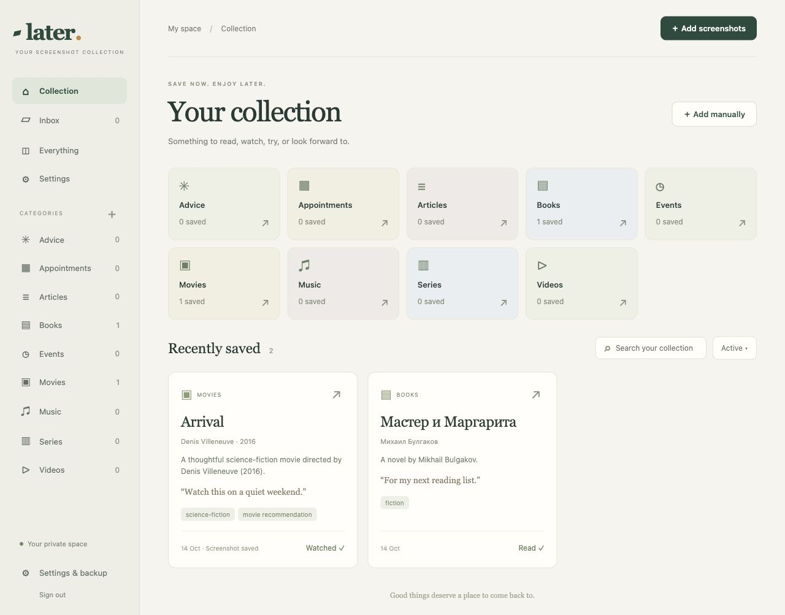

# Later — Screenshot Manager

A private, self-hosted collection for things you screenshot and want to come back to: books, articles, music, videos, movies, series, advice, events, and appointments.



Upload from a phone or computer → let your model propose useful details → review and correct → save to category pages. Search, personal comments, tags, archiving, and original screenshots are included.

This is a working prototype, designed for one private collection per installation. Its local LM Studio mode requires no subscription, paid API, or public hosting. Optional OpenRouter, Google AI, and Hugging Face integrations can use free allowances subject to each account's quotas and billing settings. You supply the server and storage. Electricity and hardware costs still apply.

## What is included

- Responsive browser interface for iPhone, Android, and computers; no Apple-only dependency.
- Password login and authenticated screenshot access.
- Separate bulk submissions, or several screenshots grouped as one submission.
- Comments before extraction and editable comments during review.
- Durable serial queue, background extraction, retries when the model is unavailable, and manual creation when it fails.
- English/Russian image understanding through an image-capable model; Tesseract OCR fallback for text models.
- Multiple proposals from one submission, editable details, relevant source text, and summaries.
- Multiple categories per entry, editable category names, tags, search, and category browsing.
- Possible duplicate suggestions during review. Merging preserves existing comments, appends the new comment, and retains screenshots. It replaces other fields with the reviewed values; it never happens automatically.
- Active and archived views, Read/Watched actions, confirmed permanent deletion, and optional screenshot removal.
- ZIP export/restore of collection data and images, excluding login and model credentials.

No automatic calendar insertion or reminders, separate user accounts, native Share Sheet integration, offline browser synchronization, or public hosting configuration. The adapters are isolated in `app/extraction.py`; no automatic fallback changes your selected service.

## Quick start on a computer

Python 3.11+ is enough for the app. No Python packages or frontend build step are required.

```sh
git clone https://github.com/JuliaAga/screenshot-manager.git
cd screenshot-manager
python3 -m app.server
```

Open [http://127.0.0.1:8787](http://127.0.0.1:8787), create a password of at least 12 characters, and open **Settings & backup**. All data goes into the ignored `data/` directory.

For a text-only model, install Tesseract plus English and Russian language data separately. On Debian/Raspberry Pi OS:

```sh
sudo apt-get install tesseract-ocr tesseract-ocr-eng tesseract-ocr-rus
```

The Docker image includes those packages. An image-capable model does not need OCR.

## Docker installation

Install Docker Engine and its Compose plugin from the [official instructions](https://docs.docker.com/engine/install/debian/). Copy/download this repository and run commands from its directory:

```sh
cp .env.example .env
docker compose up -d --build
```

The default binding is **127.0.0.1:8787**, so the app is reachable only on its host. Create the collection password before making it accessible to other devices. For a headless server, use an SSH tunnel from your laptop:

```sh
ssh -L 8787:127.0.0.1:8787 YOUR_USER@YOUR_SERVER
```

Then open `http://127.0.0.1:8787` on that laptop and complete setup.

Data persists in the `later-data` named volume. Do not run `docker compose down -v` unless you intend to delete that volume. Normal rebuilds preserve it.

If your OS provides the older standalone `docker-compose` command instead of the Compose plugin, use `sudo docker-compose -f compose.yaml` in place of `docker compose` in these instructions. Include `-f compose.yaml` explicitly. This is the package available on the initial Raspbian Bookworm Pi installation.

### Raspberry Pi 2 / ARMv7

The application uses Python and SQLite and processes one submission at a time. The heavy language model runs on another computer, not the Pi.

The Dockerfile uses Debian Bookworm and has been built and run natively on a physical Raspberry Pi 2 (`linux/arm/v7`). It is also intended to support `linux/arm64` and `linux/amd64`; those container builds have not been tested yet. Docker's Debian packages support armhf/ARMv7; Docker's own Raspberry Pi OS 32-bit package channel ends at v28, so follow its [ARMv7 migration guidance](https://docs.docker.com/engine/install/raspberry-pi-os/).

Compose requests a 384 MB memory limit, which requires kernel memory-cgroup support. The initial Pi's kernel does not provide it, so Docker reports no memory/swap limit support and does not enforce that cap. Its boot configuration was left unchanged. Large images and OCR can stress a Pi 2; resize images and monitor available memory. Limits are 10 images, 8 MB each, 20 MB total per upload, and 24 megapixels per image. Storage usage is not automatically capped; monitor disk space.

No prebuilt Docker image is published yet. Build locally with Compose. A maintainer can build multi-platform images later using Docker Buildx; image publication is separate from running the app.

## Connect LM Studio

1. On the model computer, enable **Serve on Local Network** in LM Studio's Developer/server settings.
2. Enable **Require Authentication**, create an API token, and keep the token private.
3. Load your chosen model yourself. The app never calls model load/unload endpoints.
4. In Later → Settings & backup, enter the server address, exact model key or loaded instance identifier, and token. Save, then choose **Test saved connection**.

Example configuration (use your model computer’s address):

```text
Server: http://MODEL_SERVER:1234
Model:  qwen/qwen3.8-27b
Mode:   Auto
```

Replace that address and model for your own installation. `http://SERVER:1234/v1` is also accepted. The browser talks only to Later; Later contacts LM Studio, so the model credentials never appear in frontend responses.

The app uses `/api/v1/models` to inspect loaded instances and image capability, then `/v1/chat/completions` with a JSON schema. LM Studio 0.4.26 is the initial target. If the model is unloaded or the computer is off, uploads remain queued. Retry intervals back off from 30 seconds to a maximum of 15 minutes. An explicit retry or settings change retries sooner. The default inference timeout is 300 seconds.

Auto mode sends images when the model advertises vision; otherwise it recognizes text locally with English/Russian Tesseract and sends that text. Vision-only mode fails clearly for a text-only model. If image support is advertised but misconfigured, the app reports the error; it does not quietly switch modes or providers.

The model must support structured output adequately. Invalid, empty, or truncated responses produce a Failed submission with manual/retry options. All proposals require your review before entering the collection. Screenshots are untrusted input and model output is validated; review is still necessary for accuracy, especially advice and dates.

**Avoid unwanted loading:** disable LM Studio's JIT loading if you want a strict guarantee that a model unloaded between our availability check and inference will not reload. The app itself never requests loading, but LM Studio can independently load on an inference call. See [LM Studio loading behavior](https://lmstudio.ai/docs/developer/core/ttl-and-auto-evict).

Official references: [network serving](https://lmstudio.ai/docs/developer/core/server/serve-on-network), [API authentication](https://lmstudio.ai/docs/developer/core/authentication), [model metadata](https://lmstudio.ai/docs/developer/rest/list), [structured output](https://lmstudio.ai/docs/developer/openai-compat/structured-output).

## Optional free-tier providers

Settings & backup → AI provider offers LM Studio, OpenRouter, Google AI/Gemini, and Hugging Face. Each provider has its own saved model and key; switching back preserves the previous settings. Legacy installations remain on LM Studio. Keys are never returned to the browser or included in portable collection exports.

Selecting a dropdown option does not switch processing until you save. External providers require an explicit checkbox confirming that pending/future screenshots or OCR text and comments will leave your server, and that you configured the free-account conditions. The app never switches services automatically. OpenRouter/Hugging Face may route requests to their own inference partners.

| Provider | Setup | Free-use limits |
|---|---|---|
| LM Studio | Local address and already-loaded model; optional token | No API bill; your hardware must run the model |
| OpenRouter | [Create an API key](https://openrouter.ai/settings/keys); default `openrouter/free` | Only `openrouter/free` or `:free` models; quotas and availability vary |
| Google AI | [Google AI Studio API key](https://aistudio.google.com/apikey); `gemini-3.8-flash` (recommended), or another listed free-tier model | Use a free-tier project with billing disabled; quota/region/account eligibility varies |
| Hugging Face | [Token with Inference Providers permission](https://huggingface.co/settings/tokens); choose a currently available model from its [playground](https://huggingface.co/playground) | Free accounts currently get $0.10/month, subject to change; avoid paid plans, purchased credits, and custom paid-provider keys |

OpenRouter token prices are checked against its catalog before inference, and requests constrain prompt/completion prices to zero. Its free router chooses an available free model supporting the request. If free models are unavailable, the upload waits or reports an error; a paid model is not selected by this app.

**Google/Hugging Face are account-based free allowances, not a universal zero-cost guarantee.** This app cannot inspect your Google billing tier or all Hugging Face payment settings. A paid account/key may incur charges. Configure an unbilled/free account if you require zero spending. Google's free-tier content may be used to improve its products. Check the providers' current terms before sending private material: [Google pricing/data policy](https://ai.google.dev/gemini-api/docs/pricing), [HF credits/billing](https://huggingface.co/docs/inference-providers/pricing), [OpenRouter free router](https://openrouter.ai/docs/guides/routing/routers/free-router).

Save provider settings, then Test active provider. Tests check key/model access using metadata requests, not image inference; the first screenshot checks extraction compatibility. Cloud integrations have regression tests with mocked API responses. Google Flash Lite was also verified with a live API request. For HF text models choose Local OCR + text model. For vision models choose Auto/image input. Your chosen model must support structured JSON output; unsupported combinations fail visibly instead of falling back to another service.

Google may list legacy 2.5 models in metadata while rejecting generation for new accounts; choose a listed 3.x model if this happens.

Rate-limit responses remain queued with backoff. Payment/credit-required responses fail with a clear message. No credits are purchased and no billing settings are changed by the app. Use a smaller screenshot batch when a provider rejects its request-size limit.

## Private access from phones and outside home

Install Tailscale on the server and your devices, then use **Tailscale Serve** to expose the loopback app privately over HTTPS:

```sh
tailscale serve --bg http://127.0.0.1:8787
```

Use the HTTPS address printed by Tailscale. Set `COOKIE_SECURE=1` in `.env` and run `docker compose up -d` again when serving through HTTPS. For native Python startup, set the same environment variable before launching. Secure cookies cannot be used over ordinary HTTP.

Use **Serve**, not public Funnel. No router port forwarding is required. Follow [Tailscale Serve documentation](https://tailscale.com/docs/features/tailscale-serve) and check [current plan terms](https://tailscale.com/pricing); its Personal plan is currently free for eligible personal use. Tailscale is an external connectivity service, even though your collection remains on your server. HTTPS certificates disclose server DNS names in certificate transparency logs.

For temporary access only on your trusted home network, change `BIND_ADDRESS` to your server's LAN IP and leave `COOKIE_SECURE=0`. HTTP does not encrypt passwords or screenshots; prefer the HTTPS path above. Do not expose this prototype directly to the public internet.

## Daily use

1. Open the web app on any device; optionally add a home-screen shortcut using your browser.
2. Choose **Add screenshots** and select files from Photos, Files, or your computer.
3. For a long post, check **These screenshots belong to one item or post**. Otherwise each image is a separate submission with its own optional comment.
4. Check **Inbox** for Waiting, Processing, Ready to review, or Needs attention status.
5. Review proposals next to the source images. Edit title, categories, tags, link, comment, summary, and details. Expand Relevant source text to inspect what was retained.
6. Uncheck proposals you do not want. Choose a possible existing match only if you want to update it. Save the selected entries.
7. Browse categories or search. Mark books Read or movies Watched to archive; restore them through the Archived view.

Use Create manually on a pending upload when you don't want to wait for AI. Editing a queued comment triggers fresh extraction. Retry extraction replaces unsaved proposals; saved entries are unaffected.

## Backup and restore

**Portable collection export:** Settings & backup → Download backup. This ZIP includes entries, category names, comments, original images, and pending uploads. It excludes passwords, sessions, model address/token, and model configuration. Browser restore replaces the current collection after confirmation; existing login/model settings remain. Pending extraction restarts after restore.

Browser restore is limited to a compressed file of 20 MB and 256 MB uncompressed. For large collections, use a complete server backup instead. Exports may use substantial memory on a Pi, so use server backups once the collection grows.

**Full server backup:** stop the app and copy its complete data directory/volume, then restart it. This includes credentials and sessions, so keep that backup private. For Docker, from this repository:

```sh
docker compose stop later
docker compose run --rm --no-deps -T later tar -czf - -C /data . > later-server-backup.tar.gz
docker compose start later
```

For full restore, first make a backup of the current volume. Stop the service, replace the volume contents with the trusted backup using your normal server administration tools, preserve file ownership for UID 10001, and restart. Do not restore while the app is running. For native Python, stop it and copy `data/` (or your custom DATA_DIR).

SQLite and images live on your server. The model token is stored in its protected data directory, not encrypted separately from the disk. Use disk encryption/backups appropriate to your server.

## Troubleshooting

- **Waiting for AI:** load the exact configured model, check its network address, authentication, firewall, and Settings → Test saved connection.
- **Configured model not found:** copy the full key, such as `qwen/qwen3.8-27b`, not an abbreviated display name.
- **Invalid model response:** retry with fewer images or a better structured-output model. Preserve your screenshots and create manually if needed.
- **OCR missing:** use the Docker image or install Tesseract and `eng`/`rus` data.
- **Timeouts:** raise the request timeout up to 600 seconds if your model is slow. Timeouts can leave work finishing in LM Studio; this app cannot cancel a server-side inference.
- **No image support:** choose Auto/OCR or explicitly configure an image-capable model.
- **Browser cannot sign in after HTTPS setup:** Secure cookies require the HTTPS URL. Use `COOKIE_SECURE=0` only for a local HTTP test.
- **Docker cannot start:** check the Docker daemon, ARMv7 package support, port 8787, and writable data volume.
- **Forgot password:** no email reset is implemented. A server administrator can reset it offline after backing up the data. Do not delete the collection to reset access.

## Development and verification

```sh
python3 -m unittest discover -s tests -v
node --check app/static/app.js
```

Tests use temporary data and HTTP servers on loopback. They cover login/CSRF, upload validation, persistent retry/restart behavior, manual review, stale/in-flight work, duplicate merging, image cleanup, category renaming, archive/delete, credential exclusion, and validated backup restore. Python's standard library supplies the application and test runner.

See [verification results and limits](docs/VERIFICATION.md) for live-model checks and browser testing.

Code layout: `app/store.py` for persistence, `app/extraction.py` for model/OCR integration, `app/server.py` for HTTP/queue/collection operations, and `app/static/` for the browser interface.

## Sharing on GitHub

This source and documentation can be published under the included MIT license. Create a repository and push this directory after reviewing it. The project excludes `data/` and `.env`; also exclude any server backups you create. Never publish screenshots, collection databases, credentials, or personal backups.

No prebuilt Docker image is published. Native phone sharing and full cross-platform hardware validation are future work.

Auto-approve in Settings is off by default. When enabled, successful future extractions save all proposals directly as separate entries with their screenshots and personal comments. Existing review cards stay in the Inbox; duplicates are not merged automatically. Failed uploads remain available for retry or manual entry.
